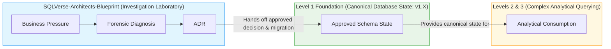

# 🗄️🤖 SQL & GenAI Course
**🎯 Quality Education for Anyone, Anywhere, Anytime — 💫 with Comfort, Convenience at no Cost**

---

# BLUEPRINT CHARTER

## SQLVerse-Architects-Blueprint — Investigation Laboratory

**Document Type:** System Charter  
**Version:** 1.0  
**Status:** FROZEN  
**Domain:** SQLVerse Foundation — Level 1, Module 4  
**Governing Standard:** `SQLVERSE-ARCH-FW-001`  

---

## 📌 Purpose

The `SQLVerse-Architects-Blueprint` is the official **investigation laboratory** for Level 1, Module 4. It provides the structured runtime environment where learners transition from basic SQL syntax to Principal Data Architecture, forensic query execution, and schema evolution.

This charter establishes the laboratory contract — the rules, boundaries, and expectations that govern every investigation performed inside the Blueprint.

---

## 🎯 Why the Blueprint Exists

The Blueprint exists to teach students how to:

1. **Diagnose** data model limitations through forensic query analysis.
2. **Evaluate** architectural trade-offs using the 11‑step reasoning pipeline.
3. **Evolve** database schemas to meet real business requirements.
4. **Document** architectural decisions in a professional Decision Ledger.
5. **Hand off** approved schema evolutions to the canonical Foundation.

**The goal is not to write more SQL. The goal is to think like a Data Architect.**

---

## 🏛️ What the Blueprint IS

| Aspect | Description |
|--------|-------------|
| **Investigation Laboratory** | A sandbox where data model deficits are identified, diagnostic queries are executed, alternatives are weighed, and Architectural Decision Records (ADRs) are logged. |
| **Forensic Workspace** | Students interrogate business pressure, diagnose structural model failures, evaluate trade-offs, and make defensible schema design decisions. |
| **Grain-First Environment** | Every investigation establishes what one row represents before evaluating whether the available data can support the required business fact at the required grain. This reasoning builds on the mathematical foundations of the relational model and the concepts developed in Grain Foundations. |
| **Decision Registry** | Every approved evolution is logged in the central `ARCHITECTURAL_DECISION_LEDGER.md`. |
| **Framework-Compliant** | All investigations follow the 11‑step pipeline defined in `SQLVERSE-ARCH-FW-001`. |

---

## ❌ What the Blueprint IS NOT

| Aspect | Description |
|--------|-------------|
| **Canonical Schema Repository** | The Blueprint does not hold the canonical schemas. Canonical database states live exclusively in the **Level 1 Foundation** (`sqlverse-foundation`). |
| **Syntax Drill Room** | The Blueprint is not for practicing SQL syntax. Students entering the Blueprint must already be proficient in `SELECT`, `FROM`, `WHERE`, `GROUP BY`, `HAVING`, `ORDER BY`, and basic `JOIN`s, and must have completed Relational Mathematics, which is read in full before Grain Foundations. |
| **Production Environment** | Investigations are conducted in a controlled laboratory setting. Schema evolutions are proposed, not deployed. |
| **Duplicate Repository** | The Blueprint does not duplicate the Foundation. The Foundation is the single source of truth for approved schema state. |

---
## 🗂️ What the Blueprint Contains

| Folder | Role | Nature |
|--------|------|--------|
| `00-CHARTER/` | The laboratory contract | Governing document |
| `01-RELATIONAL-MATHEMATICS/` | The mathematical vocabulary beneath the relational model | Reference |
| `02-GRAIN-FOUNDATIONS/` | What one row means, and what happens when grains meet | Foundations |
| `03-CASE-STUDIES/` | The seven investigations | Investigation |
| `04-THE-SQLVERSE-BUSINESS-EVOLUTION/` | How business worlds change | Narrative |
| `decisions/` | The Architectural Decision Ledger | Registry |

Only the case studies are investigations. The other folders prepare for them, govern them, or record their outcomes.

These folders share one repository tree. Sharing a tree does not make the Blueprint the owner of Relational Mathematics, which remains a standalone reference that other areas consume.

---
## 🧭 Blueprint Navigation 

All documents across `SQLVerse-Architects-Blueprint` strictly adhere to the navigation and linking convention established in this Charter.

### The Three Link Types

| Type | Use Case | Standard Form |
|---|---|---|
| **Continuation** | Next file continues the same linear argument | One sentence context, followed by the link. |
| **Threshold** | Reader crosses into a new structural area/folder | Three-part bridge (What you can now do, What comes next, Why it matters here), followed by the link. |
| **Reference** | Mid-text pointer to specific concepts | Section number, section title, and relative file link. |

### Core Navigation Rules

1. **Openings & Handoffs:** Every file except the first of the Blueprint opens with a continuation line (inside an area) or a threshold introduction (first file of a new area). Every file closes with a continuation handoff or, at the end of an area, a threshold bridge.
2. **Relative Paths & Title Integrity:** All hyperlinks must use relative file paths. Link text must always use the target's explicit title, never generic text such as "here".
3. **Section-Level References:** Cross-file references must identify the section number, section title, and linked file. A bare section number is never sufficient.
4. **Threshold Bridge Structure:** Every threshold bridge must contain three parts: **What you can now do** (2–4 bullets), **What comes next** (one short paragraph), and **Why it matters here** (one sentence). It must end with one bold **Proceed to:** link.
5. **Forward Reference Integrity:** Forward references may promise only content that exists.  If the target is not yet drafted, write "later in this folder" or "later in the Blueprint", whichever matches the scope, without creating a link.
6. **Backward Reference Integrity:** Backward references may point only to content the reader has already encountered.
7. **Strict One-Way Dependency:** Dependency runs one way: Relational Mathematics, then Grain Foundations, then Case Studies. Earlier areas may mention later areas as forward pointers, but must never cite them as previously established material.
8. **Anchor Safety:** Section anchors use plain-text headings. Emojis are omitted from anchor targets to prevent link breakage across renders.
9. **Information Secrecy:** A handoff must establish the question or direction carried forward without revealing the conclusion or resolution of the target file.

---

## 🔗 Relationship to the SQLVerse Architecture



| Layer | Role |
|-------|------|
| **Relational Mathematics** | Establishes the mathematical vocabulary beneath the relational model |
| **Grain Foundations** | Develops the concepts needed to reason about row meaning, grain alignment, joins, fan-out, and temporal history |
| **Blueprint** | Investigation Laboratory: applies those foundations to diagnose business and data-model gaps and propose solutions |
| **Foundation** | Canonical State: where approved schema evolutions are stored |
| **Levels 2 & 3** | Execution & Consumption: where evolved schemas are consumed for advanced analytics |

> The mathematical foundation sits upstream of the Blueprint. The Blueprint points to it and does not teach it.

---

## 📋 Governing Standard

Every investigation performed inside the Blueprint must execute the **11‑step reasoning pipeline** defined in `SQLVERSE-ARCH-FW-001`:

```
 01. BUSINESS PRESSURE       ──► Identify operational/financial friction
 02. BUSINESS QUESTION       ──► Define the specific stakeholder query
 03. REQUIRED FACT           ──► Isolate the required physical measurement
 04. REQUIRED GRAIN          ──► Determine the exact entity/event level
 05. CURRENT MODEL ANALYSIS  ──► Inspect DDL, PKs, FKs, constraints
 06. AVAILABLE FACT & GRAIN  ──► Isolate facts currently stored
 07. GAP DIAGNOSIS           ──► Calculate the precise delta
 08. FORENSIC PROOF          ──► Execute SQL proving schema failure
 09. SOLUTION OPTIONS        ──► Evaluate minimum 2‑3 architectural paths
 10. ARCHITECTURAL JUDGMENT  ──► Select winning path with trade‑off rationale
 11. DECISION & HAND‑OFF     ──► Write ADR entry and migration DDL/View
```

**The Blueprint does not redefine the Framework. It applies it.**

---

## 🏛️ The Grain-First Principle

Every investigation inside the Blueprint begins with the same foundational question:

> **"What does ONE row represent in this table?"**

This is the **Grain Invariant**. All analysis, diagnosis, and evolution decisions flow from this question.

```text
GRAIN QUESTION
      ↓
Table Grain = The real-world entity/event represented by ONE row
      ↓
Available Fact + Available Grain
      ↓
Required Fact + Required Grain
      ↓
GAP ANALYSIS
      ↓
ARCHITECTURAL JUDGMENT
```

**No investigation proceeds without first establishing grain.**

---

## 📂 Case Study Contracts

Case studies inside the Blueprint follow one of two standardized contracts defined in `SQLVERSE-ARCH-FW-001`:

### Contract Type A — Schema Evolution Case (DDL Modifying)

```text
case-study-folder/
├── 01-business-question.md
├── 02-current-schema-analysis.md
├── 03-data-gap-diagnosis.md
├── 04-solution-options.md
├── 05-architectural-decision.md
└── 06-schema-evolution-proposal.sql
```

### Contract Type B — Requirement Clarification Case (Non-DDL)

```text
case-study-folder/
├── 01-business-question.md
├── 02-current-model-analysis.md
├── 03-requirement-gap-diagnosis.md
├── 04-interpretation-options.md
├── 05-requirement-decision.md
└── 06-approved-business-rule.md
```

---

## 🏛️ Structural Hand‑Off Principles

| Principle | Description |
|-----------|-------------|
| **1. Non‑Destructive Baselines** | Baseline `v1.0` schemas are never altered. Schema modifications are written as forward migrations. |
| **2. Contract Strictness** | Case Studies 01–06 output Contract Type A. Case Study 07 outputs Contract Type B. |
| **3. Ledger Integrity** | Every case study resolution must log an entry in `ARCHITECTURAL_DECISION_LEDGER.md` matching `SQLVERSE-ARCH-FW-001` Section 6. |

---

## 📋 Student Workflow

1. **Orient** — Read the Blueprint Charter.
2. **Establish** the mathematical foundation — Complete Relational Mathematics in full.
3. **Build** grain reasoning — Complete Grain Foundations.
4. **Investigate** — Work through the case studies using the 11-step pipeline.
5. **Diagnose** — Identify the data-model gap and produce forensic proof queries.
6. **Evaluate and decide** — Compare alternatives, document trade-offs, and log the architectural decision in the Decision Ledger.
7. **Hand off** — Submit the approved schema evolution (Contract A) or approved business rule (Contract B) to the Foundation.

---

## 📌 Endnote

The `SQLVerse-Architects-Blueprint` is the investigation laboratory. The `sqlverse-foundation` is the canonical memory. The two are distinct, connected, and mutually reinforcing.

**The Blueprint proves why. The Foundation stores what. Level 2 inherits the evolved universe.**

---

*Part of our mission for 🎯 Quality Education for Anyone, Anywhere, Anytime — 💫 with Comfort, Convenience at no Cost.*

**SQLVerse | Architecture | Blueprint Charter | Level 1 | Module 4**
